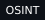
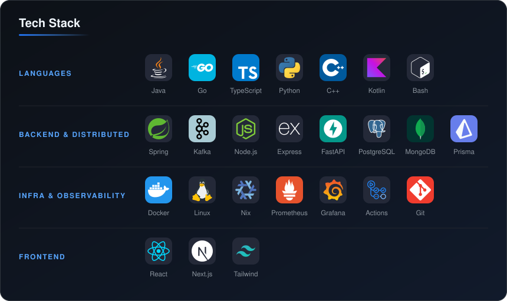

  
  

---

### About

I'm a **B.Tech Computer Science (Cyber Security)** student at **Shiv Nadar University**, Chennai. I build **scalable backend and distributed systems**: services that stay fast under load, recover on their own when parts fail, and are secure by design.

- **Distributed systems:** chunked storage, replication, self-healing repair, event-driven services on Kafka
- **Infrastructure:** QEMU/KVM virtualization, containerized environments, observability with Prometheus, Grafana and Jaeger
- **Security:** adaptive deception networks, OSINT-driven threat investigation, IOC enrichment

---

### Featured Work

<table>
  <tr>
    <td colspan="2" valign="top">
      <h3><a href="https://github.com/Gokul-Nishandh/AstraStore">AstraStore</a></h3>
      S3-style distributed object store, built from scratch · lead contributor
      
Files are split into 8 MiB chunks and streamed to storage nodes in constant memory, so a 4 GB upload uses the same RAM as a 4 KB one. Each chunk is replicated across nodes over Kafka events. A heartbeat state machine (<code>HEALTHY → DEGRADED → DOWN → RECOVERING</code>) drives rate-limited self-healing repair. The platform ships as microservices for gateway, auth, upload, placement, replication, metadata and storage, with SDKs for Java, Node and Python, plus full tracing and metrics.

      
      
      
      
      
      
      
      
    </td>
  </tr>
  <tr>
    <td width="50%" valign="top">
      <h4><a href="https://github.com/senthan-07/Hornet">Hornet</a></h4>
      Adaptive AI-driven deception platform
      
Mirrors a production network into an isolated digital twin (QEMU/KVM + Cowrie), redirects hostile traffic into it, adapts decoys with a PPO policy and emits STIX 2.1 indicators.

      
      
      
    </td>
    <td width="50%" valign="top">
      <h4><a href="https://github.com/senthan-07/Minimal-Network-Lab">Minimal Network Lab</a></h4>
      On-demand VM lab orchestration
      
Spin up, access, stop and wipe isolated QEMU VMs from a Next.js dashboard, with in-browser VNC through a containerized Guacamole gateway.

      
      
      
    </td>
  </tr>
  <tr>
    <td width="50%" valign="top">
      <h4><a href="https://github.com/senthan-07/OSINT">PhishGraph</a></h4>
      Automated phishing investigation
      
Takes a suspicious URL, domain or IP, enriches it across six intel providers, builds an infrastructure graph, scores risk with explainable factors and clusters findings into campaigns.

      
      
      
    </td>
    <td width="50%" valign="top">
      <h4><a href="https://github.com/senthan-07/TeamFlow">TeamFlow</a> · <a href="https://team-flow-frontend.vercel.app/login">Live</a></h4>
      Real-time collaborative workspace
      
Shared boards with live drawing, chat, file sharing and WebRTC calls, synced over JWT-authenticated Socket.IO namespaces and persisted through Prisma on PostgreSQL in a Turborepo monorepo.

      
      
      
      
    </td>
  </tr>
</table>

---

---

---

**Open to internships and collaborations in backend, distributed systems and infrastructure.**

